<div align="center">

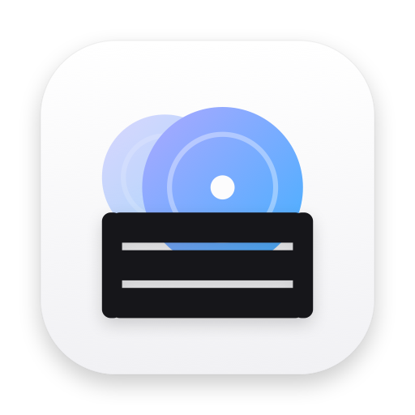

# Crate

**A native macOS music player for your Navidrome server.**

Fast because it's native and keeps your library on disk. Built for octo-fiesta, so songs you don't own yet just play.<br>
Weekly recommendations, synced lyrics, offline playlists and an autoplay that keeps the mood.

[](https://github.com/d1ff1cult0/crate/releases/latest)
[](#install)
[](https://www.swift.org)
[](https://developer.apple.com/xcode/swiftui/)
[](https://www.navidrome.org)

[Features](#features) · [Install](#install) · [Updates](#updates) · [Build from source](#build-from-source) · [How it works](#how-it-works) · [FAQ](#faq)

<br>

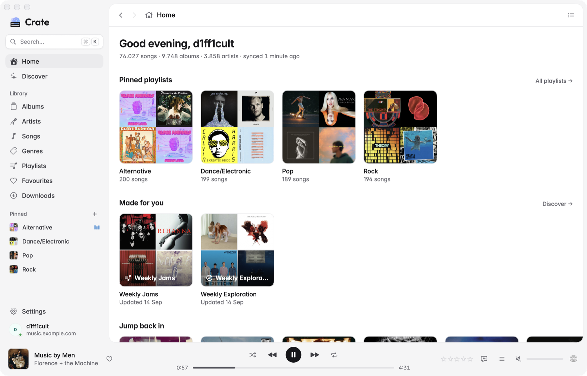

</div>

## Why Crate

Web-based players feel sluggish on a Mac, and the ones made for Navidrome have a few habits that get old fast. Crate is a small, native app that fixes the things you run into every day.

- **It opens instantly.** Your whole library (songs, albums, artists, playlists, genres and every cover) is cached on disk. After the first launch, Crate only syncs what changed.
- **Your playlists are a click away.** Pin the ones you play most to the sidebar, or press <kbd>⌘</kbd> <kbd>K</kbd> and type two letters.
- **Songs from octo-fiesta just play.** No errors and no timeouts on tracks that aren't in your library yet. Ratings and favourites on those songs stick once they land in your library.
- **Autoplay that fits.** When the queue ends, Crate keeps going with songs like the ones you just heard. It weighs your ratings, skips and favourites and keeps artists apart.
- **Recommendations every week.** ListenBrainz Weekly Jams and Weekly Exploration, a Last.fm weekly mix, and mixes from your own library.
- **It works offline.** Download playlists, albums or all your favourites. Downloaded collections stay in sync on their own.

## Features

### Pinned playlists and instant search

Pinned playlists live at the top of Playlists and in the sidebar. Drag them to reorder, or drop songs onto them to add. <kbd>⌘</kbd> <kbd>K</kbd> jumps to any playlist, album, artist or song from the local index, so results appear as you type. <kbd>⌘</kbd> <kbd>↵</kbd> plays the result directly.

<table>
  <tr>
    <td width="50%">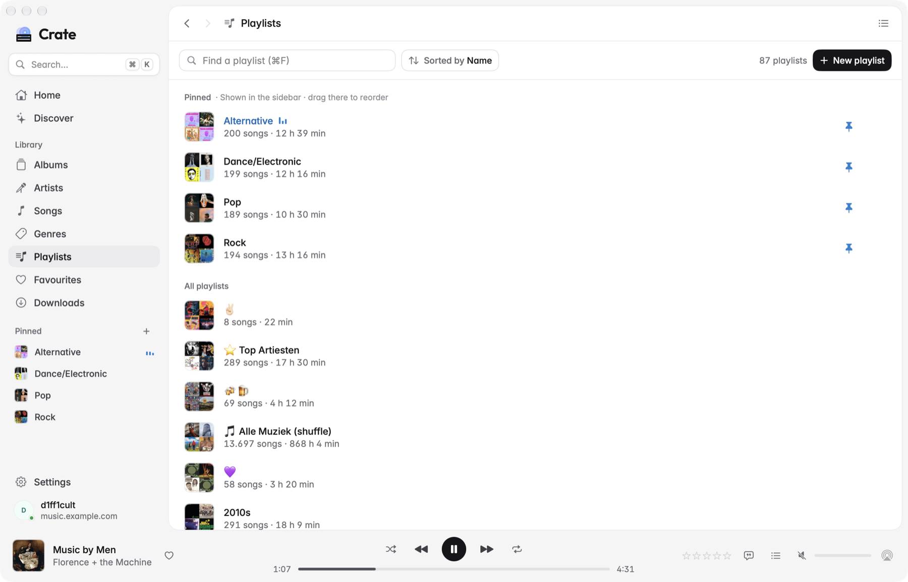<br><sub>Pinned playlists stay on top and in the sidebar</sub></td>
    <td width="50%">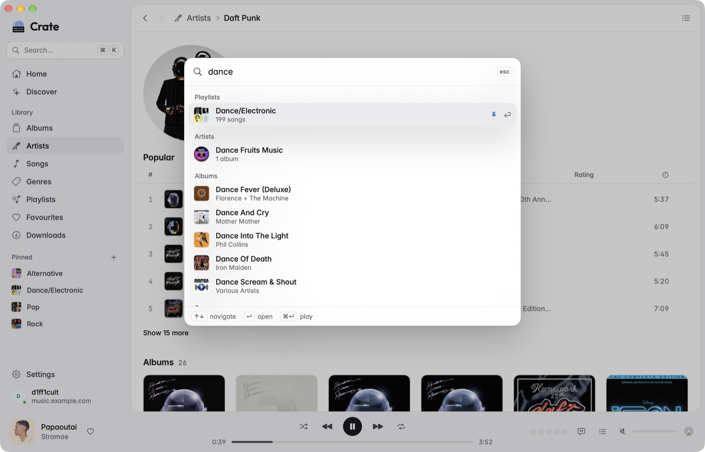<br><sub><kbd>⌘</kbd> <kbd>K</kbd> finds anything in your library</sub></td>
  </tr>
</table>

### Made for you

Crate turns ListenBrainz's weekly playlists and Last.fm's track similarity into mixes you can play, shuffle, download or save as a Navidrome playlist. Songs you already have play from your library; the rest play through octo-fiesta and are marked with a small purple dot. Mixes from your own library need no setup: On Repeat, Forgotten Favourites, Deep Cuts and more.

<table>
  <tr>
    <td width="50%">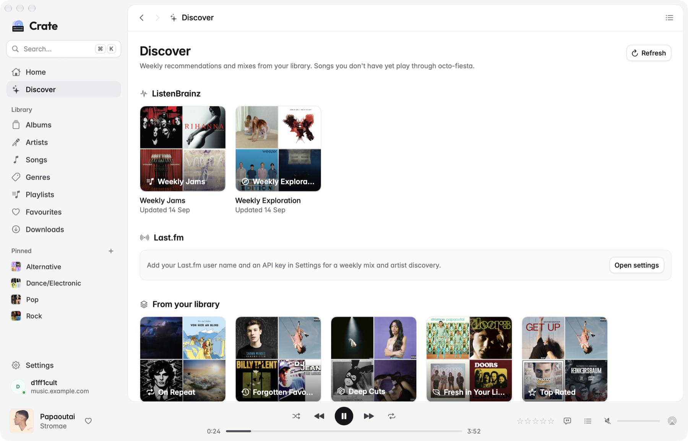<br><sub>Weekly mixes from ListenBrainz, Last.fm and your library</sub></td>
    <td width="50%">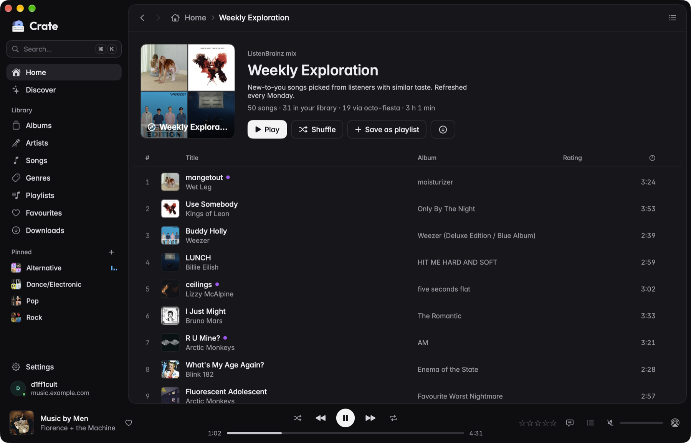<br><sub>Weekly Exploration, with songs from octo-fiesta marked</sub></td>
  </tr>
</table>

### Lyrics and a queue that keeps going

Synced lyrics follow the song; click a line to jump there. Crate uses the lyrics on your server and fetches synced ones from [LRCLIB](https://lrclib.net) when there are none. The queue shows what you picked, and under it what autoplay chose to follow.

<table>
  <tr>
    <td width="50%">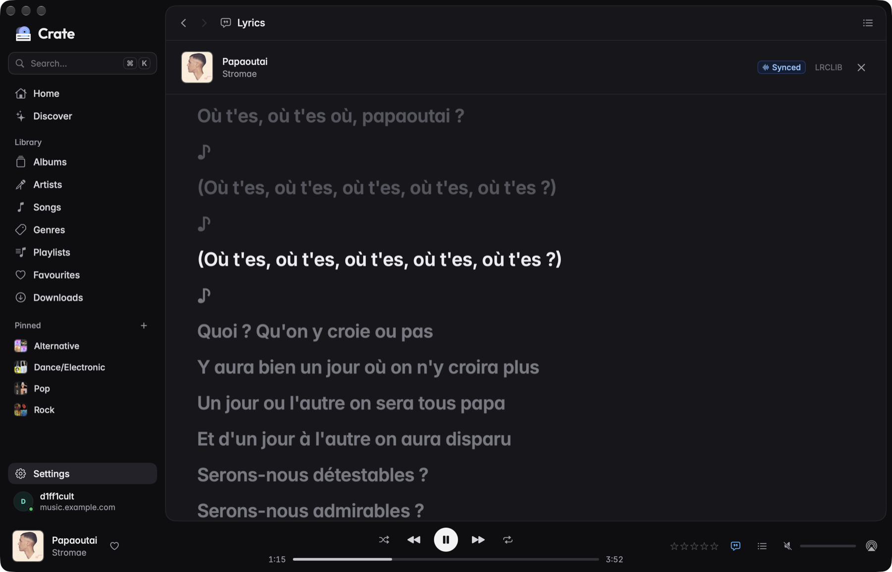<br><sub>Synced lyrics, in light or dark</sub></td>
    <td width="50%">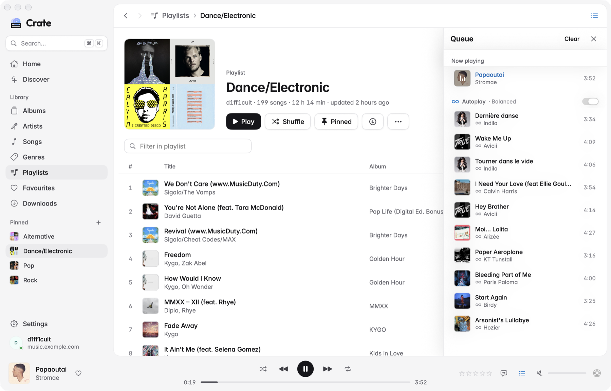<br><sub>Autoplay picks songs that fit, never the same artist twice in a row</sub></td>
  </tr>
</table>

### Your library

Albums, artists, songs and genres all browse from the local cache, so large libraries stay smooth. Rate songs from one to five stars, add favourites, download for offline, or start a radio from any song, artist, genre or playlist.

<table>
  <tr>
    <td width="50%">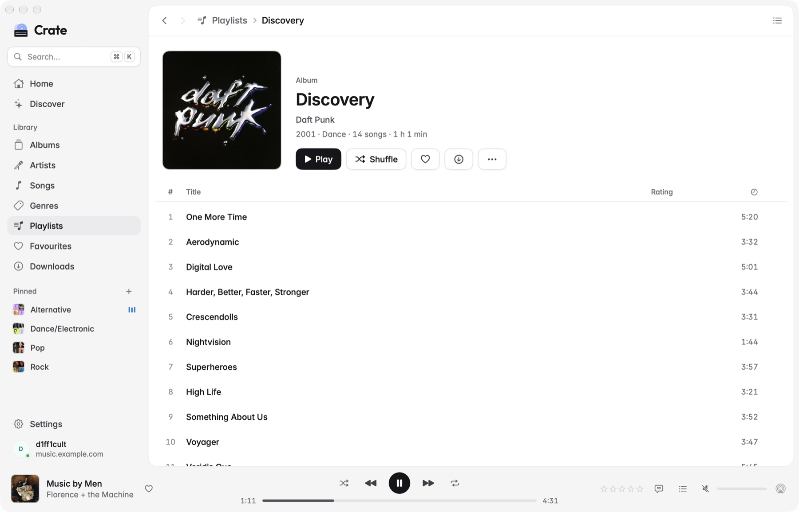<br><sub>Album pages, with octo-fiesta albums one click from your library</sub></td>
    <td width="50%">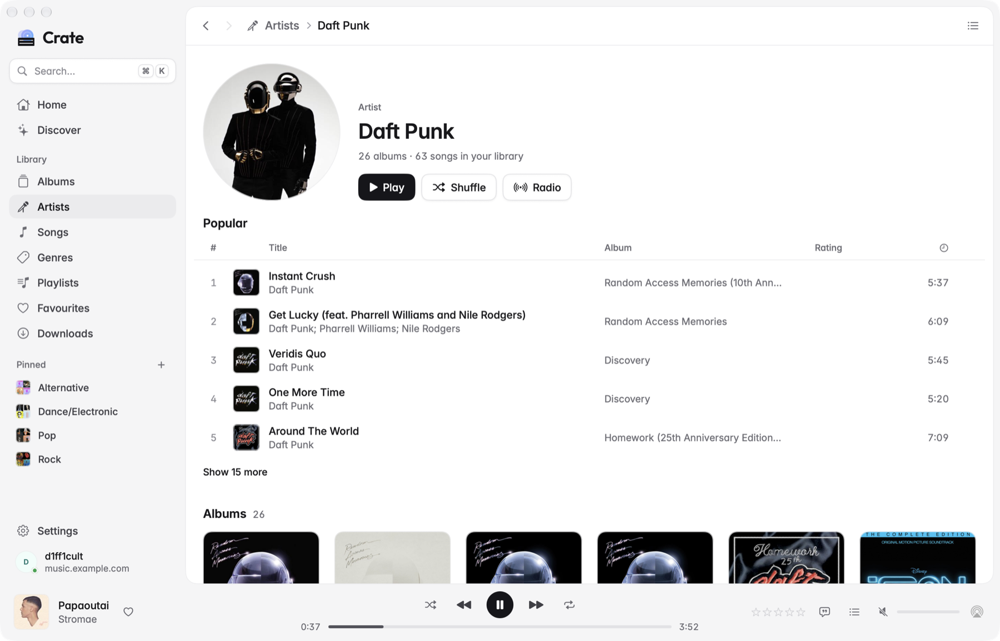<br><sub>Artists, with popular songs and similar artists</sub></td>
  </tr>
  <tr>
    <td>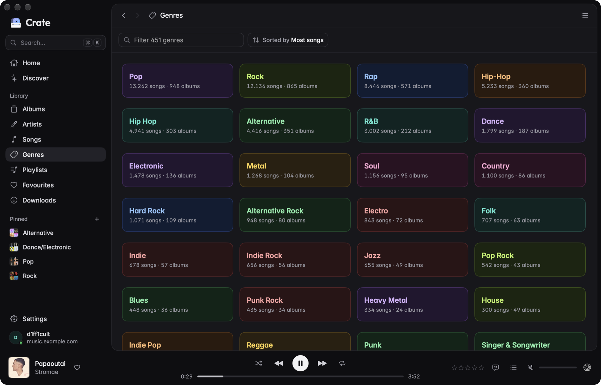<br><sub>Every genre, colour-coded</sub></td>
    <td><br><sub>Home: pinned playlists, mixes and what you played lately</sub></td>
  </tr>
</table>

### And the basics, done well

Gapless playback · shuffle and repeat · media keys and Now Playing · AirPlay · scrobbling through Navidrome or straight to ListenBrainz · light and dark mode · resizable sidebar and queue · `crate://` links for Raycast, Alfred and Shortcuts.

## Install

1. Download **Crate-x.y.z.dmg** from the [latest release](https://github.com/d1ff1cult0/crate/releases/latest).
2. Open it and drag Crate to Applications.
3. Sign in with your server address (your octo-fiesta address if you use it), user name and password.

Crate is ad-hoc signed rather than notarised. If macOS refuses to open a copy you downloaded, right-click Crate in Applications and choose **Open** once.

To get weekly recommendations, add your ListenBrainz user name and/or your Last.fm user name and API key in **Settings**.

## Updates

Crate updates itself. It checks GitHub Releases at launch and every few hours, and shows an **Update** button in the sidebar when a new version is out. Updating replaces the app in place and reopens it. Your library cache, downloads, settings, password and API keys live outside the app, so nothing has to be set up again.

You can also check by hand in **Settings → Updates**.

## Build from source

You need macOS 14 or later and Swift 6. The Command Line Tools are enough; Xcode isn't required.

```bash
git clone https://github.com/d1ff1cult0/crate.git && cd crate
make run        # fast arm64 build of dist/Crate.app, then open it
```

| Command        | What it does                                                                  |
| -------------- | ----------------------------------------------------------------------------- |
| `make run`     | Build an arm64 `dist/Crate.app` and open it                                    |
| `make app`     | Release build with a universal (arm64 + x86_64) binary                         |
| `make install` | Build and install into `/Applications`, reopening a running copy              |
| `make dev`     | Build **Crate Dev**: its own data, settings and `crate-dev://` scheme, so it runs next to your installed Crate |
| `make dmg`     | Package `dist/Crate-<version>.dmg`                                            |
| `make test`    | Run the unit tests                                                            |
| `make release` | Publish `VERSION` as a GitHub release, which installed copies offer as an update |

## How it works

- **Library cache.** The first launch indexes your whole library into SQLite: about a minute for 75,000 songs. After that Crate opens from disk and syncs incrementally whenever Navidrome scans. Every album and artist cover is downloaded once in the background, so browsing never waits for the network.
- **octo-fiesta.** octo-fiesta only starts sending an external song once it has finished downloading it from the provider, which is long enough for most players to give up. Crate fetches the file with a patient timeout, plays it locally (so seeking works), and fetches upcoming external songs ahead of time. Ratings, favourites, plays and playlist additions on those songs are kept until octo-fiesta has added them to your library, then applied to the library copy.
- **Autoplay.** Crate gathers candidates from Navidrome's similar songs, similar artists, the seed's genre, ListenBrainz radio and Last.fm similar tracks. It scores them on how many sources agree, your ratings and favourites, how recently you heard them and what you skipped, including skips in this session. Picks keep artists apart. A Familiar / Balanced / Adventurous setting decides how much is new.
- **Native, all the way down.** SwiftUI and AVFoundation, with no web view and no third-party dependencies. Long lists are lazy with fixed-size rows, hover effects wait until a scroll has stopped, covers are decoded off the main thread, and animations run on Core Animation, so lists scroll at the display's frame rate and playing music in the background costs almost nothing.

## Keyboard shortcuts

| Action                         | Keys                          |
| ------------------------------ | ----------------------------- |
| Play / pause                   | <kbd>Space</kbd>              |
| Next / previous                | <kbd>⌘</kbd> <kbd>→</kbd> / <kbd>⌘</kbd> <kbd>←</kbd> |
| Volume                         | <kbd>⌘</kbd> <kbd>↑</kbd> / <kbd>⌘</kbd> <kbd>↓</kbd> |
| Rate the current song          | <kbd>⌘</kbd> <kbd>1</kbd> … <kbd>⌘</kbd> <kbd>5</kbd>, <kbd>⌘</kbd> <kbd>0</kbd> clears |
| Favourite the current song     | <kbd>⌘</kbd> <kbd>L</kbd>     |
| Jump to anything               | <kbd>⌘</kbd> <kbd>K</kbd> or <kbd>⌃</kbd> <kbd>K</kbd> |
| Find a playlist                | <kbd>⌘</kbd> <kbd>F</kbd> on Playlists |
| Queue / lyrics                 | <kbd>⌘</kbd> <kbd>U</kbd> / <kbd>⌥</kbd> <kbd>⌘</kbd> <kbd>L</kbd> |
| Back / forward                 | <kbd>⌘</kbd> <kbd>[</kbd> / <kbd>⌘</kbd> <kbd>]</kbd> |
| Leave a text field             | <kbd>Esc</kbd>, or click anywhere else |

## FAQ

**Do I need octo-fiesta?** No. Crate works with any Navidrome server. octo-fiesta adds songs you don't own to search, recommendations and autoplay.

**Where is my data?** The library cache and downloads are in `~/Library/Application Support/Crate`, and artwork is in `~/Library/Caches/Crate`. Your password and API keys are in an encrypted file there, readable only by your user account.

**What does Crate connect to?** Your server, and only when you set them up: ListenBrainz, Last.fm and LRCLIB (lyrics). It also checks GitHub for updates. There's no telemetry.

**Can I script it?** Yes. `crate://play/playlist/<id>`, `crate://control/next`, `crate://search?q=…`, `crate://go/discover`, `crate://lyrics` and more. See `AppModel.handle(_:)`.

## Acknowledgements

[Navidrome](https://www.navidrome.org) and [octo-fiesta](https://github.com/V1ck3s/octo-fiesta) make the server side possible. Lyrics come from [LRCLIB](https://lrclib.net), and recommendations from [ListenBrainz](https://listenbrainz.org) and [Last.fm](https://www.last.fm). Crate is set in [Inter](https://rsms.me/inter/) and [Outfit](https://github.com/Outfitio/Outfit-Fonts) (both SIL Open Font License), and borrows its design language from [Dopl](https://github.com/VTKLeuven/dopl).
